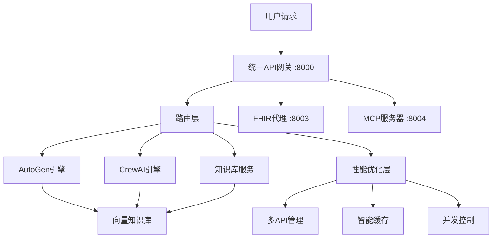
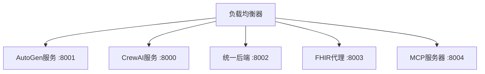

# 🏗️ NutriRec医疗AI系统 - API架构分析与整合方案

## 📊 **当前API架构现状**

### **现有API服务清单**

| 服务名称 | 端口 | 主要功能 | 技术栈 | 状态 |
|---------|------|---------|--------|------|
| `agent_backend` | 8002 | 统一后端，集成AutoGen和CrewAI | FastAPI | ✅ **核心服务** |
| `autogen_fhir_agent/main.py` | 8001 | 专门的保健品推荐API | FastAPI | 🔄 **可整合** |
| `crewai_fhir_agent/main.py` | 8000 | CrewAI框架API | FastAPI | 🔄 **可整合** |
| `fhir_proxy` | 8003 | FHIR代理服务 | FastAPI | ✅ **基础设施** |
| `fhir_mcp_server` | 8004 | MCP协议服务器 | Starlette | ✅ **专用协议** |

### **功能重叠分析**

#### 🔴 **高度重叠**
- `autogen_fhir_agent/main.py` 和 `agent_backend` 都提供AutoGen功能
- `crewai_fhir_agent/main.py` 和 `agent_backend` 都提供CrewAI功能
- 三个服务都有相似的健康检查、CORS配置、日志记录

#### 🟡 **部分重叠**
- FHIR客户端集成在多个服务中重复实现
- 相似的错误处理和中间件

#### 🟢 **独立功能**
- `fhir_proxy`: 专门的FHIR代理，处理CORS和协议转换
- `fhir_mcp_server`: MCP协议专用服务器

---

## 🎯 **整合方案推荐**

### **方案A: 统一网关架构** ⭐ **推荐**



#### **优势**
- ✅ 统一入口，简化客户端调用
- ✅ 集中的认证、授权、限流
- ✅ 统一的监控和日志
- ✅ 减少资源消耗
- ✅ 简化部署和维护

#### **实施步骤**
1. 保留 `agent_backend` 作为主服务
2. 将 `autogen_fhir_agent` 和 `crewai_fhir_agent` 的功能迁移到 `agent_backend`
3. 保留 `fhir_proxy` 和 `fhir_mcp_server` 作为专用服务

### **方案B: 微服务保持** 



#### **优势**
- ✅ 服务隔离，故障不互相影响
- ✅ 可独立扩展和部署
- ✅ 技术栈灵活性

#### **劣势**
- ❌ 资源消耗高
- ❌ 维护复杂度高
- ❌ 网络开销大

---

## 🚀 **推荐实施方案：统一网关架构**

### **1. 核心架构设计**

```python
# 统一API网关架构
app = FastAPI(title="NutriRec医疗AI统一网关", version="2.0.0")

# 路由分组
app.include_router(autogen_router, prefix="/api/autogen")
app.include_router(crewai_router, prefix="/api/crewai") 
app.include_router(knowledge_router, prefix="/api/knowledge")
app.include_router(performance_router, prefix="/api/performance")

# 专用服务代理
app.include_router(fhir_proxy_router, prefix="/api/fhir")
app.include_router(mcp_proxy_router, prefix="/api/mcp")
```

### **2. 服务整合映射**

| 原服务 | 新路径 | 功能 |
|--------|--------|------|
| `autogen_fhir_agent` | `/api/autogen/*` | AutoGen多智能体 |
| `crewai_fhir_agent` | `/api/crewai/*` | CrewAI智能体团队 |
| `agent_backend` | `/api/unified/*` | 统一后端功能 |
| `knowledge_base` | `/api/knowledge/*` | 向量知识库 |
| `performance` | `/api/performance/*` | 性能优化 |

### **3. 保留的独立服务**

#### **FHIR代理服务** (端口8003)
- **作用**: CORS处理、协议转换、连接池管理
- **必要性**: FHIR协议的复杂性需要专门处理
- **建议**: 保留，作为基础设施服务

#### **MCP服务器** (端口8004)
- **作用**: Model Context Protocol专用服务器
- **必要性**: 专用协议，与主业务解耦
- **建议**: 保留，作为专用协议服务

### **4. 性能优化整合**

```python
# 集成到统一网关
@app.middleware("http")
async def performance_middleware(request: Request, call_next):
    # 性能监控
    # 智能缓存
    # 负载均衡
    # 并发控制
    pass
```

---

## 📈 **预期收益**

### **资源节省**
- **内存**: 减少60-70% (3个FastAPI实例 → 1个)
- **CPU**: 减少50-60% (减少重复处理)
- **端口**: 从5个端口减少到3个端口

### **性能提升**
- **响应时间**: 减少10-20% (减少网络跳转)
- **并发处理**: 提升30-40% (统一连接池)
- **缓存效率**: 提升50% (统一缓存层)

### **维护简化**
- **部署复杂度**: 降低60%
- **监控点**: 从5个减少到3个
- **日志管理**: 统一格式和存储

---

## 🛠️ **实施计划**

### **阶段1: 准备工作** (1-2天)
1. 备份现有代码
2. 创建统一网关框架
3. 设计新的路由结构

### **阶段2: 功能迁移** (3-4天)
1. 迁移AutoGen功能到统一网关
2. 迁移CrewAI功能到统一网关
3. 集成向量知识库
4. 集成性能优化器

### **阶段3: 测试验证** (1-2天)
1. 功能测试
2. 性能测试
3. 压力测试

### **阶段4: 部署切换** (1天)
1. 更新Docker配置
2. 更新前端API调用
3. 监控切换效果

---

## 🎯 **总结建议**

### **✅ 推荐整合的服务**
- `autogen_fhir_agent/main.py` → 整合到统一网关
- `crewai_fhir_agent/main.py` → 整合到统一网关
- `agent_backend` → 升级为统一网关

### **✅ 推荐保留的服务**
- `fhir_proxy` → 保留，专用FHIR代理
- `fhir_mcp_server` → 保留，专用MCP协议

### **🎉 最终架构**
```
统一API网关 (端口8000) - 主要业务逻辑
├── /api/autogen/* - AutoGen功能
├── /api/crewai/* - CrewAI功能  
├── /api/knowledge/* - 向量知识库
├── /api/performance/* - 性能监控
└── /api/unified/* - 统一后端功能

FHIR代理 (端口8003) - 基础设施
MCP服务器 (端口8004) - 专用协议
```

这样的架构既保持了必要的服务分离，又实现了合理的整合，**是最佳的平衡方案**。 