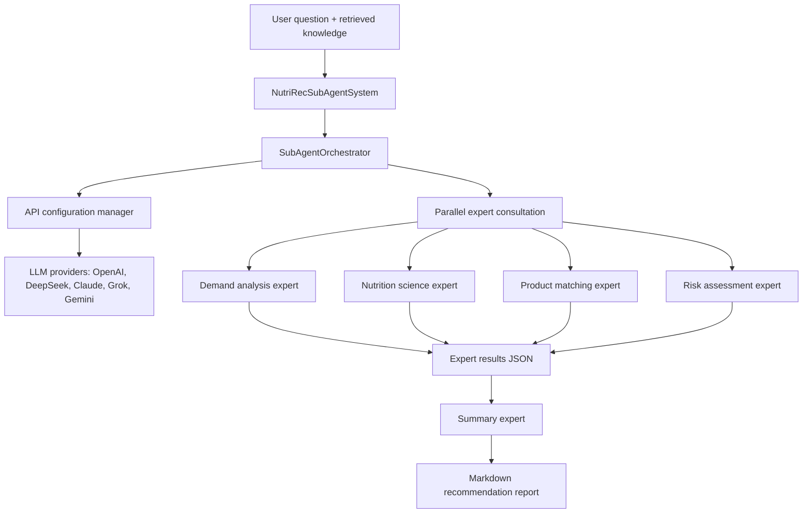

# NutriRec: Nutrition and Supplement Recommendation Agents

[](https://www.python.org/downloads/)
[](LICENSE)

A multi-agent decision-support system for nutrition and supplement consultations. A user's
question is analyzed in parallel by specialist LLM agents, grounded in a retrieval-augmented
knowledge base (FAISS) and FHIR R4 patient records, checked by a risk-assessment agent and
response validation, and summarized into a structured recommendation report.

This project is built on [agentic-healthcare-ai](https://github.com/amitpuri/agentic-healthcare-ai)
by Dr. Amit Puri (MIT), which provides the FHIR infrastructure, the React console and the
deployment setup. The table below marks which parts come from that base.

> **Data notice.** This repository contains code only. No patient records, product catalogs,
> clinic lists or knowledge-base indexes are included. Bring your own data in the formats
> described in [`autogen_fhir_agent/knowledge_base/README.md`](autogen_fhir_agent/knowledge_base/README.md).

## What this project adds

- **Parallel expert consultation** (`supplement_subagent/`): demand-analysis, nutrition-science,
  product-matching and risk-assessment agents run concurrently on any of five LLM providers
  (OpenAI, DeepSeek, Claude, Grok, Gemini); a summary agent merges their JSON outputs into a
  Markdown report.
- **Retrieval-augmented knowledge base** (`autogen_fhir_agent/vector_knowledge_manager.py`):
  FAISS indexes over clinic, Q&A and supplement documents, plus medical keyword extraction,
  clinic matching, a function registry for agent tools and FHIR data conversion.
- **Safety layer** (`shared/`): a security gateway with request validation and rate limiting,
  content filtering with medical disclaimers, response validation of agent outputs, agent
  isolation, audit logging, per-call cost monitoring and a security dashboard.
- **Serving** (`subagent_api_server.py`, `autogen_fhir_agent/api_routes.py`): signed HTTP
  endpoints that expose the agents to chat front ends.

## Architecture



## Components

| Path | Purpose | Origin |
|---|---|---|
| `supplement_subagent/` | Parallel expert agents, orchestrator and summary agent | This project |
| `autogen_fhir_agent/` | AutoGen service: API routes, vector knowledge base, clinic matching, keyword extraction, FHIR conversion | This project (Docker files from base) |
| `shared/` | Security gateway, content security, response validation, audit, cost monitoring, agent isolation | This project, except `fhir_client.py`, `fhir_tools.py`, `llm_communication_tracker.py` |
| `subagent_api_server.py` | HTTP backend for the expert system | This project |
| `crewai_fhir_agent/`, `agent_backend/` | CrewAI agents and agent backend | Base |
| `fhir_mcp_server/`, `fhir_proxy/`, `fhir_mcp_client_examples/` | Model Context Protocol server and proxy exposing FHIR resources as agent tools | Base |
| `ui/` | React + TypeScript console | Base |
| `config/`, `docker/`, `kubernetes/`, `scripts/`, `docs/` | Configuration, deployment and guides | Base, plus `config/security.yaml` and `docs/MCP_SETUP_GUIDE.md` |

## Quick start

Prerequisites: Python 3.9+, Docker and Docker Compose, and an API key for at least one LLM provider.

```bash
git clone https://github.com/WilliamQiuzy/nutrition-advisor-agent.git
cd nutrition-advisor-agent

# Configure provider keys through environment variables, never in code
export OPENAI_API_KEY=...          # or DEEPSEEK_API_KEY, etc.

# Full stack with Docker
docker compose -f docker/docker-compose.yml up -d

# Or run the AutoGen service locally
cd autogen_fhir_agent
pip install -r requirements.txt
python main.py
```

A local FHIR server for development can be created with `python autogen_fhir_agent/setup_fhir_server.py`.

## Example request

```bash
curl -X POST "http://localhost:8000/api/v1/secure/supplement-recommendation" \
  -H "Content-Type: application/json" \
  -d '{"user_id": "user123", "query": "I often feel tired. Which supplements could help?"}'
```

## Tests

```bash
python supplement_subagent/test_subagent.py
python autogen_fhir_agent/test_clinics_simple.py
```

## License

MIT, see [LICENSE](LICENSE). The base project is copyright Dr. Amit Puri; the additions listed
above are copyright Ziyue Qiu.

**Disclaimer:** recommendations produced by this system are for reference only and do not
replace professional medical diagnosis or treatment.
